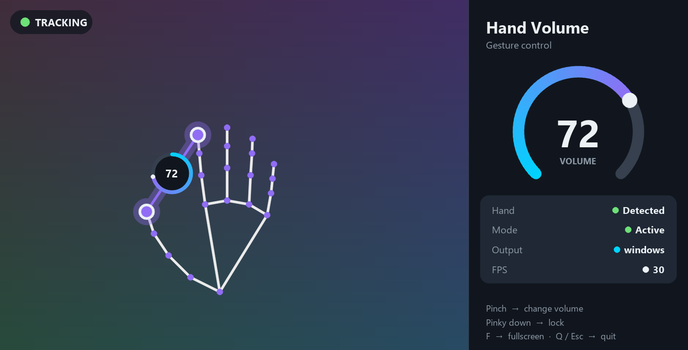

<p align="center">
  
</p>

<h1 align="center">Hand Volume Control</h1>

<p align="center">
  Control your computer's volume with your hand: no mouse, no keyboard, just your webcam.
</p>

<p align="center">
  <a href="https://github.com/iqramalik12/HandVolumeControl/releases/latest/download/HandVolumeControl-Setup.exe"></a>
  &nbsp;
  <a href="https://github.com/iqramalik12/HandVolumeControl/releases/latest/download/HandVolumeControl-macOS.dmg"></a>
  &nbsp;
  <a href="https://github.com/iqramalik12/HandVolumeControl/releases/latest/download/HandVolumeControl-Linux.tar.gz"></a>
</p>

<p align="center">
  
</p>

## Install

### Windows 10 / 11

1. Click **Windows - Download** above. You get `HandVolumeControl-Setup.exe`.
2. Double-click it. If Windows says *"Windows protected your PC"*, click **More info**, then **Run anyway**.
3. Click **Next**, then **Install**. No admin password is needed.

Open it any time from the **Hand Volume Control** icon on your Desktop, or search "Hand Volume" in the Start Menu.
Uninstall: **Settings > Apps > Hand Volume Control > Uninstall**.

### macOS (Apple Silicon: M1, M2, M3, M4)

1. Click **macOS - Download** above and open `HandVolumeControl-macOS.dmg`.
2. Drag **Hand Volume Control** into the **Applications** folder.
3. The app isn't from the App Store, so the first time macOS blocks it. Open **System Settings > Privacy & Security**, scroll down and click **Open Anyway** next to Hand Volume Control.
   (Or run this once in Terminal: `xattr -dr com.apple.quarantine "/Applications/Hand Volume Control.app"`)
4. Click **Allow** when it asks for the camera.

Open it from Launchpad or Spotlight. Uninstall: drag it from Applications to the Trash.

### Linux (64-bit, Ubuntu 22.04+ / Debian / Fedora / Mint...)

```sh
tar -xzf HandVolumeControl-Linux.tar.gz
cd HandVolumeControl
./install.sh
```

Then open **Hand Volume Control** from your app menu. The volume uses `pactl` (PulseAudio/PipeWire) or `amixer` (ALSA), which most desktops already have.

## How to use

| Gesture / key | What it does |
| --- | --- |
| Pinch thumb + index finger together | Volume down |
| Spread them apart | Volume up |
| Fold your little finger (pinky) down | Lock the volume |
| `C` | Switch camera mode (if the picture looks garbled or wrong) |
| `F` | Fullscreen on/off |
| `Q` or `Esc` | Quit |

The window can be resized. You need a webcam; close Zoom, Teams or other camera apps first if the camera doesn't open. The app picks a working camera mode by itself and reconnects if the camera drops out; if the picture still looks wrong, press `C`.

## Updates

New versions appear under [Releases](https://github.com/iqramalik12/HandVolumeControl/releases). The download buttons above always give the newest version. On Windows, running the new Setup updates the installed app in place.

---

© Hand Volume Control. All rights reserved. The app is free to download and use; the source code is not published.
